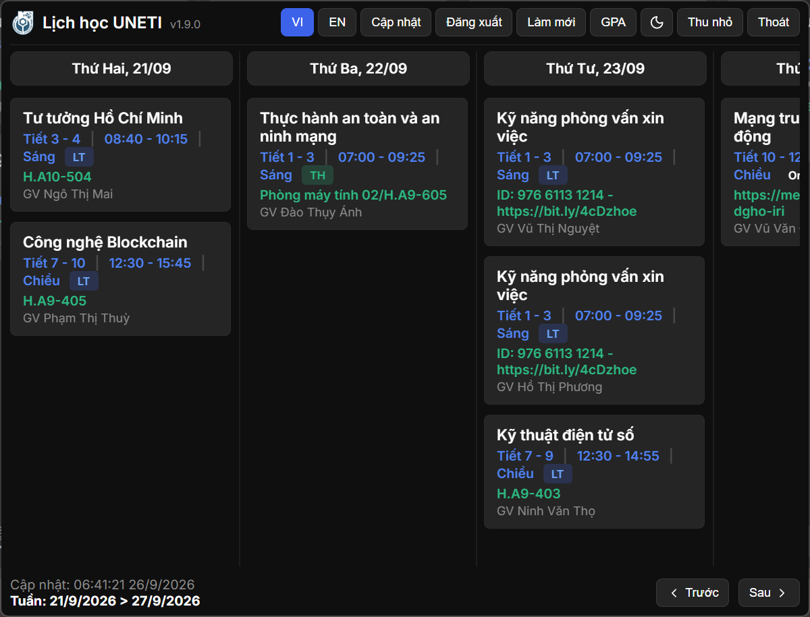
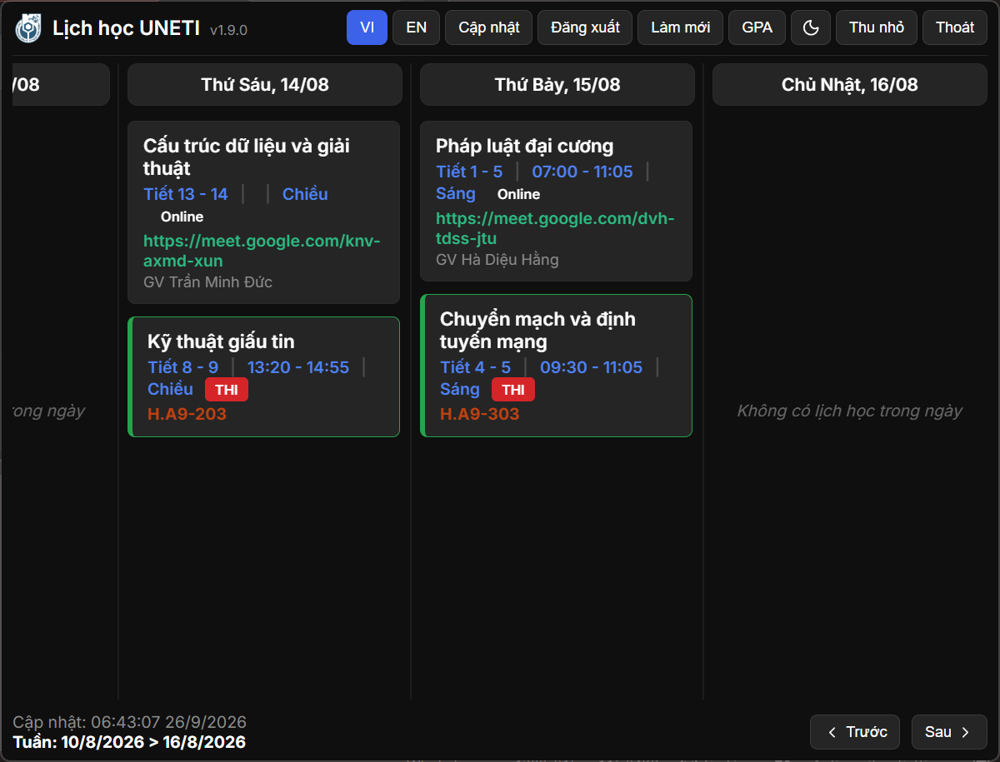
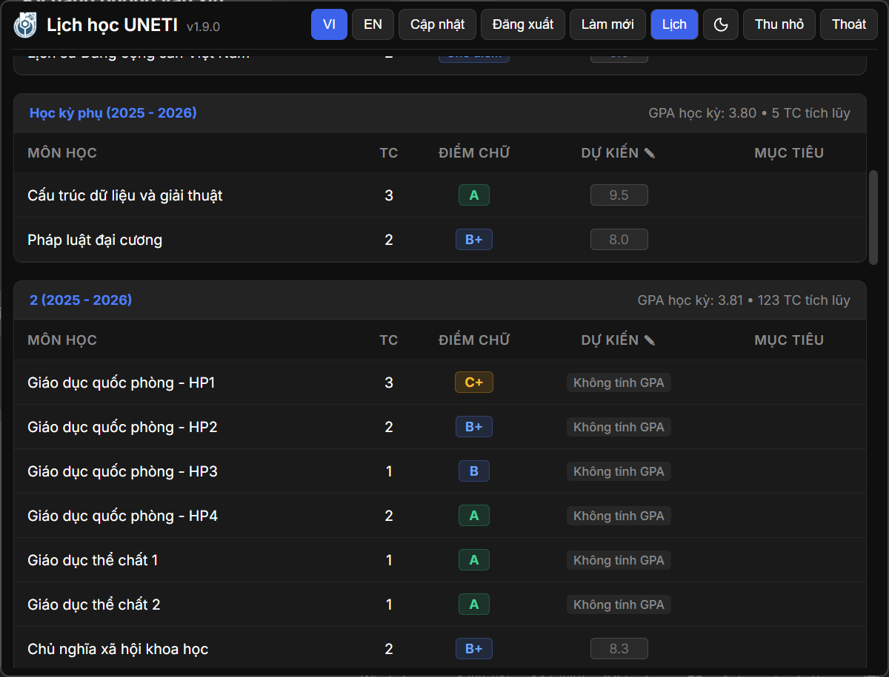
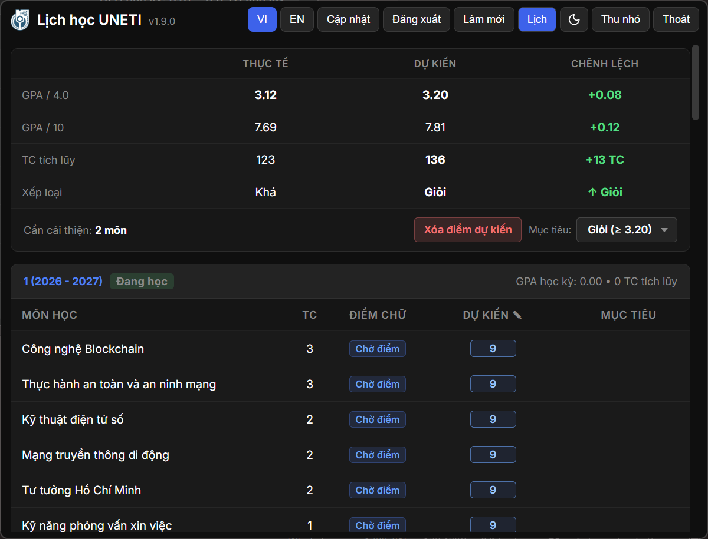
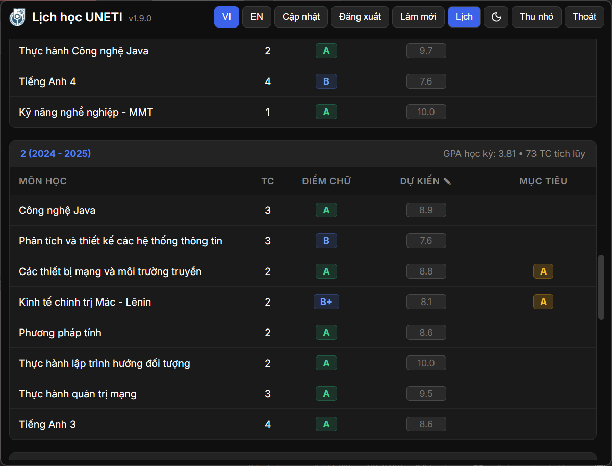

# Widget Lịch học UNETI

UNETI Schedule Widget là một ứng dụng desktop giúp sinh viên UNETI xem lịch học nhanh chóng và tiện lợi.


---

## Giới thiệu

Widget này mình viết để theo dõi lịch học UNETI cho tiện. Thay vì phải mở trình duyệt, đăng nhập vào trang lịch của trường rồi thao tác nhiều bước mỗi lần muốn xem - và đôi khi website còn không truy cập được - thì giờ chỉ cần click vào tray icon là xong.

Ứng dụng hỗ trợ xem offline, nên ngay cả khi server trường gặp sự cố hoặc mất kết nối internet, bạn vẫn có thể xem lịch đã lưu.

Ứng dụng tự động làm mới tuần hiện tại mỗi giờ và tuần sau mỗi 6 giờ khi đang chạy, có kết nối và phiên đăng nhập còn hiệu lực. Ngoài ra, bạn cũng có thể bấm Làm mới thủ công bất cứ lúc nào khi cần.

## Một số hình ảnh của Widget

<p align="center">
  
</p>
<p align="center"><i>Lịch học thường</i></p>

<p align="center">
  
</p>
<p align="center"><i>Lịch thi</i></p>

<p align="center">
  
</p>
<p align="center"><i>Bảng điểm và GPA</i></p>

<p align="center">
  
</p>
<p align="center"><i>Mô phỏng điểm GPA & biến động xếp loại</i></p>

<p align="center">
  
</p>
<p align="center"><i>Gợi ý môn cần cải thiện điểm số để đạt mục tiêu</i></p>

## Tính năng chính

- Hiển thị lịch học theo tuần
- Tự động làm mới: tuần hiện tại mỗi 1 giờ, tuần sau mỗi 6 giờ
- Hoạt động offline (dùng lịch đã lưu)
- Xem bảng điểm, tính GPA hệ 4 và hệ 10, mô phỏng điểm dự kiến và lập kế hoạch cải thiện GPA. Các môn không tính GPA được phân loại riêng.
- Dark/Light theme
- Tiếng Việt/English
- Tray icon để truy cập nhanh
- Tự động kiểm tra cập nhật mỗi 6 giờ

## Cài đặt

### Yêu cầu

- Windows 10/11 (64-bit)

### Cách cài

1. Tải file `.exe` từ [Releases](https://github.com/hoaug-tran/uneti-schedule-app/releases)
2. Chạy installer
3. Mở ứng dụng và đăng nhập bằng tài khoản UNETI

> [!IMPORTANT]
> Lần đầu cần internet để đăng nhập. Sau đó ứng dụng vẫn chạy được khi offline.

## Lưu ý & Từ chối trách nhiệm

> [!IMPORTANT]
> **TỪ CHỐI TRÁCH NHIỆM**
>
> Dự án này là một sáng kiến mã nguồn mở độc lập và **KHÔNG** trực thuộc, được ủy quyền hay liên kết với **Trường Đại học Kinh tế - Kỹ thuật Công nghiệp (UNETI)**.
>
> Ứng dụng hoạt động bằng cách truy cập cổng thông tin sinh viên public dưới danh nghĩa người dùng đã đăng nhập để tải dữ liệu lịch. Người dùng tự chịu trách nhiệm khi sử dụng. Tác giả không chịu trách nhiệm về bất kỳ lỗi hiển thị, lỡ lịch học/thi hay các vấn đề khác phát sinh từ việc sử dụng phần mềm.

> [!NOTE]
> Bộ cài hiện chưa có chữ ký số nên Windows có thể hiển thị tên nhà phát hành là "Unknown Publisher". Chỉ tải từ trang Releases của project và kiểm tra đúng phiên bản trước khi cài.

## Sử dụng

### Đăng nhập

Mở ứng dụng lần đầu sẽ hiện cửa sổ đăng nhập. Nhập tài khoản / mật khẩu trang sinh viên UNETI như bình thường.

> [!NOTE]
> Bạn nhập mật khẩu trên trang đăng nhập UNETI. Ứng dụng lưu cookie phiên bằng Windows Credential Manager hoặc cơ chế mã hóa của hệ điều hành để truy cập dữ liệu theo tài khoản của bạn.

### Xem lịch

Sau khi đăng nhập, lịch sẽ tự động hiển thị. Dùng nút "← Trước" và "Sau →" để chuyển tuần.

### Xem & Lập kế hoạch GPA

1. Click vào nút **GPA** trên thanh điều hướng.
2. Hệ thống sẽ tự động load kết quả học tập chính thức từ trang sinh viên UNETI và tính toán GPA hệ 4, hệ 10 (theo kỳ và toàn khóa). Kỳ đang học được tự động nhận diện và hiển thị số tín chỉ đăng ký cùng danh sách môn chờ điểm thi.
3. **Chọn mục tiêu**: Chọn xếp loại mong muốn (**Xuất sắc $\ge 3.60$**, **Giỏi $\ge 3.20$**, **Khá $\ge 2.50$**).
4. **Gợi ý tự động**: Bấm nút **Gợi ý tự động** (✨), hệ thống sẽ phân tích và tự động chọn số môn ít nhất cần nâng lên điểm A để đạt xếp loại mục tiêu.
5. **Mô phỏng tùy chỉnh**: Bạn có thể tự chọn mục tiêu (A, B+, B, C, D) cho từng môn ở cột **Mục tiêu**, hoặc gõ thẳng điểm số vào ô **Dự kiến ✎**. Cả hai sẽ tự đồng bộ 2 chiều theo thời gian thực và cập nhật ngay lập tức bảng tổng kết GPA bên trên. Bấm **Đặt lại** để quay về điểm thực tế ban đầu bất cứ lúc nào.
6. Các môn không tính GPA (như Thể dục, Quốc phòng, kiểm tra Tiếng Anh đầu vào TOEIC...) được nhận diện và tự phân loại riêng, không ảnh hưởng đến điểm tích lũy.

### Làm mới lịch

Click nút "Làm mới" để tải lịch mới nhất từ server. Nên làm mới trước những ngày quan trọng (thi, nộp đồ án...).

> [!TIP]
> Ứng dụng tự động làm mới mỗi giờ, nhưng bạn vẫn nên bấm "Làm mới" thủ công trước ngày thi để chắc chắn.

### Menu ở khay hệ thống

Chuột phải vào tray icon để mở menu:

- **Khởi động cùng Windows**: Tự động chạy khi khởi động máy
- **Xoá dữ liệu lịch**: Xoá lịch đã lưu (dùng khi lịch bị lỗi)
- **Đăng xuất**: Đăng xuất tài khoản và xoá hoàn toàn dữ liệu người dùng
- **Xem nhật ký**: Xem file log (để debug khi có lỗi)
- **Giới thiệu**: Xem version của ứng dụng, thông tin của dev
- **Tự động kiểm tra cập nhật**: Tự động kiểm tra cập nhật khi có phiên bản mới (mặc định bật)
- **Thoát**: Thoát ứng dụng

## FAQ

**Q: Ứng dụng có miễn phí không?**  
A: Có, hoàn toàn miễn phí và open-source.

**Q: Ứng dụng có lưu mật khẩu không?**  
A: Không. Ứng dụng chỉ lưu cookie session được mã hóa tại máy của bạn, không lưu mật khẩu.

**Q: Tại sao nhiều khi phải đăng nhập lại?**  
A: Cookie của trường (UNETI) với mỗi tài khoản của sinh viên có thời hạn. Khi hết hạn thì phải đăng nhập lại.

**Q: Lịch có chính xác không?**  
A: Lịch được lấy từ UNETI. Khi mất mạng hoặc không tải được dữ liệu mới, lịch đã lưu có thể chưa phản ánh thay đổi của trường; hãy đối chiếu cổng sinh viên khi cần.

**Q: Ứng dụng có hoạt động offline không?**  
A: Có. Ứng dụng có thể dùng lịch đã lưu trong tối đa 30 ngày; lịch quá 6 giờ sẽ có cảnh báo. Khi có mạng và phiên đăng nhập còn hiệu lực, ứng dụng sẽ thử tải dữ liệu mới.

**Q: Dữ liệu lưu ở đâu?**  
A: `%APPDATA%/uneti-schedule-widget/`. Cookie được lưu qua Windows Credential Manager hoặc mã hóa bằng cơ chế của hệ điều hành.

## Xử lý sự cố

### Không đăng nhập được

**Mô tả lỗi**: Click nút Đăng nhập nhưng không mở cửa sổ đăng nhập.

**Thử các cách sau**:

1. Kiểm tra kết nối internet
2. Kiểm tra xem cổng sinh viên UNETI có đăng nhập được trên trình duyệt không
3. Tắt ứng dụng đi và mở lại
4. Chuột phải tray → Đăng xuất → Thử lại

### Lịch bị sai hoặc thiếu

**Mô tả lỗi**: Lịch không khớp với trang web UNETI.

**Thử các cách sau**:

1. Click nút "Làm mới"
2. Nếu vẫn sai: Chuột phải tray → Xoá dữ liệu lịch → Thử lại
3. Kiểm tra log: Chuột phải biểu tượng khay hệ thống → Xem nhật ký

### Chuyển tuần bị văng ra đăng nhập

**Mô tả lỗi**: Khi chuyển tuần click vào nút Trước/Sau bị chuyển hướng về màn hình đăng nhập.

**Nguyên nhân**: Cookie hết hạn.

**Giải pháp**: Đăng nhập lại.

### Thông báo "Bạn đang Offline" không biến mất

**Mô tả lỗi**: Dù đã có mạng nhưng vẫn hiện thông báo offline.

**Thử các cách sau**:

1. Đợi 5-10 giây
2. Click nút "Làm mới"
3. Khởi động lại ứng dụng
4. Nếu vẫn bị, chuột phải vào icon tray → Thoát → Mở lại ứng dụng

### Ứng dụng không tự cập nhật / không thể cập nhật

**Mô tả lỗi**: Ứng dụng không tự cập nhật phiên bản mới, hoặc đơn giản là không thể tự động cập nhật.

**Nguyên nhân có thể**:

- Kết nối mạng không ổn định
- Quyền ghi file bị chặn bởi antivirus / Windows Defender
- File update bị xóa trong quá trình tải
- Lỗi trong ứng dụng hoặc bộ cài; xem nhật ký để xác định nguyên nhân

**Giải pháp**:

1. Thoát hoàn toàn ứng dụng
2. Truy cập trang [Releases](https://github.com/hoaug-tran/uneti-schedule-app/releases)
3. Tải và cài đặt **phiên bản mới nhất**
4. Ghi đè lên bản cũ (không cần gỡ cài đặt trước)

> [!NOTE]
> Sau khi nâng cấp, ứng dụng có thể yêu cầu đăng nhập lại nếu phiên đã hết hạn hoặc định dạng dữ liệu lưu thay đổi.

### Ứng dụng không tự động khởi động

**Mô tả lỗi**: Dù đã bật "Khởi động cùng Windows" nhưng không tự khởi động.

**Thử các cách sau**:

1. Chuột phải vào tray icon → Tắt "Khởi động cùng Windows"
2. Đợi 2 giây
3. Chuột phải vào tray icon → Bật lại
4. Restart máy để test

> [!WARNING]
> Nếu vẫn gặp lỗi, vui lòng mở [issue](https://github.com/hoaug-tran/uneti-schedule-app/issues) trên GitHub hoặc liên hệ qua email.

## Phát triển

### Công nghệ sử dụng

- Electron 44.x
- JavaScript (ES Modules)
- JSON để lưu lịch và kết quả học tập
- Keytar và Electron safeStorage để bảo vệ cookie
- Lucide Icons & Vanilla CSS

### Chạy từ source

```bash
git clone https://github.com/hoaug-tran/uneti-schedule-app.git
cd uneti-schedule-app
npm ci
npm run dev
```

### Build

```bash
npm run build -- --publish never
```

Bộ cài nằm trong `dist/`. Chạy `npm run check` và `npm test` trước khi build.

Nội dung GitHub Release được lấy tự động từ mục khớp version trong [CHANGELOG.md](CHANGELOG.md). Hướng dẫn thử máy chủ cập nhật: [TEST_UPDATE_SERVER.md](docs/TEST_UPDATE_SERVER.md).


## Giấy phép

MIT License - xem file [LICENSE](LICENSE).

## Liên hệ

**Trần Kính Hoàng (hoaug)**

- GitHub: [@hoaug-tran](https://github.com/hoaug-tran)
- Facebook: [hoaugtr](https://facebook.com/hoaugtr)
- Email: hi@trkhoang.com

---

Made with ❤️ by Trần Kính Hoàng - Sinh viên Trường Đại học Kinh tế - Kỹ thuật Công Nghiệp (UNETI).
